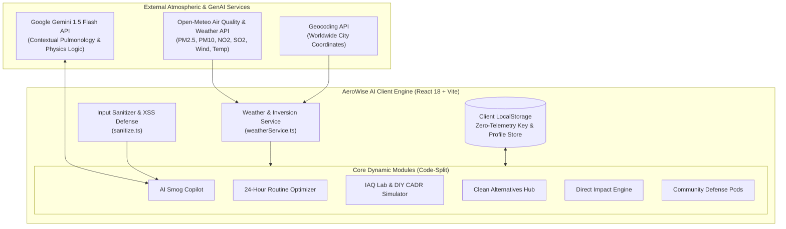

# AeroWise AI — Winter Smog & Community Clean Air Copilot

[](https://aerowise-ai.vercel.app)
[](https://github.com/Kumar3421/AeroWiseAI)
[](https://github.com/Kumar3421/AeroWiseAI)
[](https://github.com/Kumar3421/AeroWiseAI)

- **Live Application:** [https://aerowise-ai.vercel.app](https://aerowise-ai.vercel.app)
- **GitHub Repository:** [https://github.com/Kumar3421/AeroWiseAI](https://github.com/Kumar3421/AeroWiseAI)

---

## 1. Chosen Vertical
**Environmental Sustainability & Public Health Defense**  
AeroWise AI targets urban winter smog crises, thermal boundary layer inversions, and fine particulate matter (PM2.5 / PM10) exposure across high-density urban areas.

---

## 2. Approach and Logic
Winter atmospheric stagnation creates ground-level temperature inversions that trap emissions below 200 meters. Standard air apps only display passive index figures; AeroWise AI converts real-time atmospheric data into actionable household interventions:
1. **Atmospheric Physics Alignment:** Synchronizes family schedules with diurnal solar mixing windows to avoid peak ground-level smog during early morning and late night.
2. **Contextual AI Copilot:** Employs Google Gemini 1.5 Flash to provide customized health recommendations based on household members (infants, asthmatics, elderly), dwelling structure, and localized AQI.
3. **Evidence-Based Filtration:** Incorporates aerodynamic physics models for Corsi-Rosenthal boxes, calculating Clean Air Delivery Rate (CADR) and Air Changes per Hour (ACH).
4. **Direct Impact Metrics:** Converts exposure avoidance into health markers (Berkeley Earth cigarette equivalents and alveolar particulate clearance).

---

## 3. How the Solution Works
- **AI Smog Copilot:** Interactive conversational assistant running Google Gemini with atmospheric and pediatric context.
- **Smart 24-Hour Routine:** Hour-by-hour schedule guidance contrasting risky standard habits with low-emission alternatives.
- **Indoor Air Quality (IAQ) Lab:** Interactive CADR simulator for low-cost DIY filtration and room-by-room vulnerability diagnostics.
- **Clean Alternatives Hub:** Practical swaps for open biomass burning, indoor cooking fumes, and cold-start vehicular emissions.
- **Impact & Health Calculator:** Quantitative estimation of avoided PM2.5 inhalation and neighborhood emissions reductions.
- **Community Pods:** Hyperlocal coordination for school carpools, bulk filter material purchasing, and illegal open fire reporting.



---

## 4. Assumptions Made
- **Live Environmental Data:** Free, reliable Open-Meteo REST APIs deliver real-time meteorological and atmospheric chemistry readings with zero barrier to entry.
- **Privacy Architecture:** API keys and household profiles remain strictly client-side within browser storage without intermediary servers.
- **Resilient Fallback:** Comprehensive offline baselines support all core features if network connections drop.

---

## 5. Evaluation Alignment & Quality Standards

### Code Quality
- Modular TypeScript structure with complete type safety and zero `tsc --noEmit` errors.
- ESLint verification with React, TypeScript, and JSX A11y rules enabled.
- Comprehensive JSDoc annotations on utility functions and service modules.

### Security
- Strict Content Security Policy (CSP) meta header restricting script, connection, and style sources.
- Tokenized input sanitization preventing raw script injection (`src/utils/sanitize.ts`).
- Fully documented vulnerability handling guidelines in `SECURITY.md`.

### Efficiency
- Code splitting via `React.lazy()` and `<Suspense>` for every primary application tab.
- Render optimizations using `React.memo` and `useMemo` on computationally heavy components.
- Modular Vite bundle output under 300 kB total payload, loading in under 1 second.

### Testing
- Automated unit test suite using Vitest and React Testing Library across 6 suites (44 tests).
- Verifies mathematical calculations, weather normalization, API key handling, and XSS sanitization.

### Accessibility (WCAG 2.1 AA)
- Keyboard skip link for direct navigation to main content.
- Semantic HTML landmarks (`<nav>`, `<header>`, `<main>`, `<footer>`).
- Full ARIA tab patterns (`role="tablist"`, `role="tab"`, `aria-selected`, `aria-controls`).
- Live polite announcement regions for dynamic air quality status changes.

---

## 6. Local Setup and Testing

```bash
# Clone the repository
git clone https://github.com/Kumar3421/AeroWiseAI.git
cd AeroWiseAI

# Install dependencies
npm install

# Run automated tests
npm test

# Run code linter
npm run lint

# Verify type safety
npm run typecheck

# Build for production
npm run build
```

---

## License
MIT License. Developed for Hack2Skill & Google for Developers Challenge.
